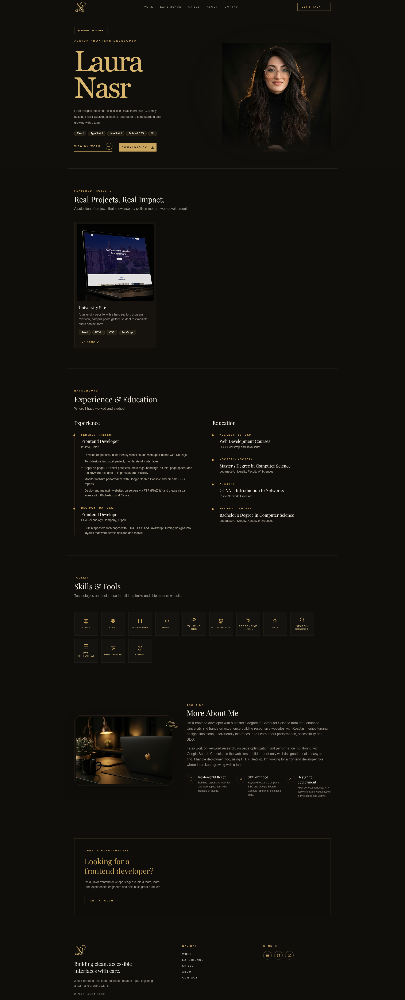

# Laura Nasr | Portfolio

Personal portfolio website showcasing my work as a frontend developer.

**Live site:** https://laura-nasr.vercel.app/



## About

I'm a frontend developer with hands-on experience building responsive
websites with React.js. This portfolio presents my projects, experience
and skills.

## Built with

- React
- TypeScript
- Tailwind CSS
- Vite

## Features

- Fully responsive design (mobile, tablet, desktop)
- Dark and gold theme
- Smooth in-page navigation with active section highlighting
- Accessible, semantic markup

## Run locally

```bash
git clone https://github.com/LauraNasr/portfolio.git
cd portfolio
npm install
npm run dev
```

## Contact

- LinkedIn: https://www.linkedin.com/in/laura-nasr-154219221
- Email: lauramehsennasr9@gmail.com
